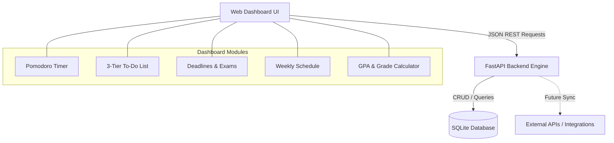

# Study Dashboard ("StudyPulse") — Project Plan & Architecture

A customizable, widget-based web dashboard designed to organize university and personal studies, featuring a Pomodoro timer, 3-tier emergency to-do list, assignment/exam deadlines, weekly schedule, and a GPA calculator. 

Built with **Python (FastAPI)** and a clean, responsive frontend. Designed as a hands-on software engineering project for mastering REST APIs, backend service layers, and full-stack web integration.

---

## Tech Stack

- **Backend**: Python 3.10+, FastAPI, SQLite, SQLAlchemy / Pydantic
- **Frontend**: HTML5, Tailwind CSS, Modern JavaScript (Fetch API / ES Modules)
- **Testing**: Pytest, FastAPI TestClient

---

## Architecture Overview

### Key Architectural Concepts
1. **Context Separation (Personal vs. Uni)**:
   Every data model (tasks, deadlines, schedule items) has a `scope` tag: `'university'` or `'personal'`. The UI features a global toggle to filter or view combined metrics.
2. **Layered Architecture**:
   - `models/`: Database tables (Data persistence).
   - `schemas/`: Pydantic data schemas (Request/Response validation & serialization).
   - `routers/`: API endpoints handling HTTP requests.
   - `services/`: Core business logic (e.g., GPA calculation algorithms, urgency prioritization).
   - `static/` / `frontend/`: Client UI assets.
