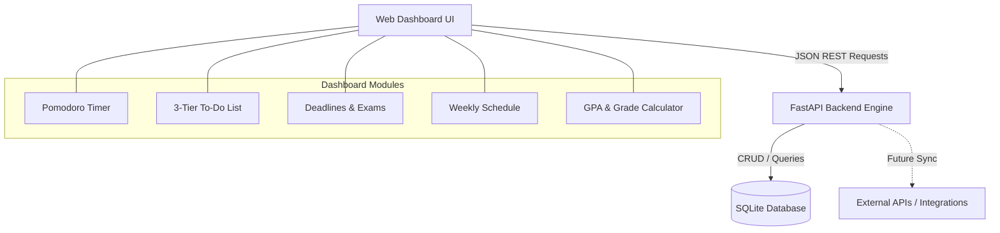

# Study Dashboard ("StudyPulse") — Project Plan & Architecture

A customizable, widget-based web dashboard designed to organize university and personal studies, featuring a Pomodoro timer, 3-tier emergency to-do list, assignment/exam deadlines, weekly schedule, and a GPA calculator. 

Built with **Python (FastAPI)** and a clean, responsive frontend. Designed as a hands-on software engineering project for mastering REST APIs, backend service layers, and full-stack web integration.

---

## Tech Stack

- **Backend**: Python 3.10+, FastAPI, SQLite, SQLAlchemy / Pydantic
- **Frontend**: HTML5, Tailwind CSS, Modern JavaScript (Fetch API / ES Modules)
- **Testing**: Pytest, FastAPI TestClient

---

## Architecture Overview



### Key Architectural Concepts
1. **Context Separation (Personal vs. Uni)**:
   Every data model (tasks, deadlines, schedule items) has a `scope` tag: `'university'` or `'personal'`. The UI features a global toggle to filter or view combined metrics.
2. **Layered Architecture**:
   - `models/`: Database tables (Data persistence).
   - `schemas/`: Pydantic data schemas (Request/Response validation & serialization).
   - `routers/`: API endpoints handling HTTP requests.
   - `services/`: Core business logic (e.g., GPA calculation algorithms, urgency prioritization).
   - `static/` / `frontend/`: Client UI assets.

---

## Roadmap & Disciplined Schedule

### 📅 Daily Sprint Schedule (Sept 10 – Sept 21)
*Pacing: ~1.5 to 2 hours per day with concrete milestones.*

**Day 1 (Sep 10)** | **Scaffolding & Server Setup**<br>*(Virtualenv, FastAPI, REST basics)* | - Set up `.venv` & dependencies (`fastapi`, `uvicorn`, `sqlalchemy`, `pydantic`).<br>- Create project layout (`backend/`, `frontend/`).<br>- Working `GET /api/health` returning JSON.

**Day 2 (Sep 11)** | **Data Modeling & SQLite**<br>*(SQLAlchemy ORM, database design)* | - Configure SQLite engine & session in `database.py`.<br>- Define DB models: `Task`, `Deadline`, `Course`, `ScheduleSlot`.<br>- Auto-create tables on startup.

**Day 3 (Sep 12)** | **Tasks & Urgency API**<br>*(CRUD operations, Pydantic validation)* | - Pydantic schemas for Tasks (`Create`, `Response`).<br>- Endpoints: `POST /api/tasks`, `GET /api/tasks` (with `scope` & `urgency` query filters), `PATCH /api/tasks/{id}`. 

**Day 4 (Sep 13)** | **Deadlines & Courses API**<br>*(Query parameters, REST standards)* | - CRUD endpoints for Deadlines and Courses.<br>- Test all endpoints interactively in Swagger UI (`/docs`). 

**Day 5 (Sep 14)** | **GPA Calculator Service & Pytest**<br>*(Algorithms, Unit Testing)* | - Implement `services/gpa_calc.py` (cumulative GPA, weighted grades).<br>- Write unit tests in `pytest` for edge cases (0 credits, letter conversion). 

**Day 6 (Sep 15)** | **Frontend Base & Dashboard Shell**<br>*(CSS Grid/Flexbox, UI State)* | - Build clean responsive dashboard shell (header, sidebar/tabs, widget grid).<br>- Add global context toggle: **University** vs **Personal** vs **All**.<br>- Write `frontend/js/api.js` reusable fetch helper. 

**Day 7 (Sep 16)** | **Widget 1: 3-Tier Emergency To-Do**<br>*(DOM manipulation, async/await)* | - Build 3 visual columns/sections: 🔴 High (Urgent), 🟡 Medium, 🟢 Low.<br>- Connect to backend: load tasks, check off tasks, add new task. 

**Day 8 (Sep 17)** | **Widget 2: Deadlines Countdown**<br>*(Date calculations, visual cues)* | - Render upcoming exams/assignments sorted by date.<br>- Countdown badge (e.g., "In 2 days", "Tomorrow!").<br>- Filter by Uni vs Personal context. 

**Day 9 (Sep 18)** | **Widget 3: Pomodoro Timer**<br>*(JavaScript Timers, Audio/Events)* | - 25m work / 5m break countdown with Start, Pause, Reset.<br>- Audio chime or notification on completion.<br>- Log completed focus sessions to backend API. 

**Day 10 (Sep 19)** | **Widget 4 & 5: GPA & Schedule**<br>*(Data visualization, tabular data)* | - GPA Widget: shows current GPA, credits summary, and target grade helper.<br>- Schedule Widget: "Today's Agenda" or weekly timetable cards. 

**Day 11 (Sep 20)** | **External API Integration & Polish**<br>*(Consuming 3rd party APIs, UI refinement)* | - Practice external API: daily motivational quote / study tip banner.<br>- Smooth transitions, empty states, error banners. 

**Day 12 (Sep 21)** | **Final Testing & Demo Ready!**<br>*(End-to-end verification, git commit)* | - Full walkthrough testing (all widgets talk to backend).<br>- Document setup instructions in README.<br>- Project completion celebration! 🚀 

---

### Milestone Breakdown

- Set up Python virtual environment (`.venv`) and dependencies.
- Initialize modular directory structure.
- Configure FastAPI app with a health-check endpoint (`GET /api/health`).
- Set up SQLite database connection and base ORM models.

### Milestone 2: Core Data Models & REST APIs
- Define schemas and database models:
  - **Task**: `id`, `title`, `description`, `urgency` (`HIGH` / `MEDIUM` / `LOW`), `scope` (`UNI` / `PERSONAL`), `completed`, `due_date`.
  - **Deadline / Exam**: `id`, `title`, `course_name`, `date`, `weight_percentage`, `scope`.
  - **Course & Grade**: `id`, `course_name`, `credits`, `grade_point`, `target_grade`.
  - **Schedule Slot**: `id`, `day_of_week`, `start_time`, `end_time`, `title`, `location`, `scope`.
- Implement CRUD endpoints with FastAPI routers.
- Explore and test endpoints interactively via Swagger UI (`/docs`).

### Milestone 3: Business Logic Engine
- Write dedicated Python service modules:
  - **GPA Calculator Service**: Cumulative GPA, weighted semester GPA, what-if scenario calculator.
  - **Urgency Matrix Engine**: Automatic sorting / prioritization of tasks based on urgency level and upcoming deadlines.
  - **Pomodoro Session Logger**: Study sessions and statistics (total focus time per category).

### Milestone 4: Dashboard Frontend & Widget Integration
- Build base responsive layout with sidebar/navbar (context switcher: Uni / Personal / All).
- Construct individual interactive widgets:
  - **Pomodoro Widget**: Client-side countdown timer with customizable work/break intervals.
  - **3-Tier To-Do Widget**: High (Urgent/Emergency), Medium (Important), Low (Routine/Backlog) task columns.
  - **Deadlines Widget**: Next 7-day deadlines countdown with color-coded alerts.
  - **Schedule Widget**: Weekly calendar grid or "Today's Agenda".
  - **GPA Calculator Widget**: Quick summary badge + modal/page for detailed course grades.

### Milestone 5: Polish, Practice Testing & External APIs
- Write unit tests using `pytest` for the backend logic (especially GPA calculation & task filtering).
- Add external API integration (e.g., daily motivational quotes, weather, or `.ics` calendar export).

---

## Project Structure

```
.
├── backend/
│   ├── app/
│   │   ├── __init__.py
│   │   ├── main.py              # FastAPI application entrypoint
│   │   ├── database.py          # SQLite engine and session setup
│   │   ├── models/              # SQLAlchemy database models
│   │   │   ├── __init__.py
│   │   │   ├── task.py
│   │   │   ├── deadline.py
│   │   │   ├── course.py
│   │   │   └── schedule.py
│   │   ├── schemas/             # Pydantic schemas (request/response validation)
│   │   │   ├── __init__.py
│   │   │   ├── task.py
│   │   │   ├── course.py
│   │   │   └── ...
│   │   ├── routers/             # API route handlers
│   │   │   ├── tasks.py
│   │   │   ├── deadlines.py
│   │   │   ├── courses.py
│   │   │   └── pomodoro.py
│   │   └── services/            # Business logic (e.g. GPA calculations)
│   │       ├── gpa_calc.py
│   │       └── urgency.py
│   ├── tests/
│   │   └── test_gpa.py
│   └── requirements.txt
├── frontend/                    # Web UI (HTML, CSS, JS)
│   ├── index.html               # Main dashboard
│   ├── css/
│   │   └── styles.css
│   └── js/
│       ├── api.js               # Centralized fetch wrapper for backend
│       ├── pomodoro.js          # Timer logic
│       ├── tasks.js             # To-do logic
│       └── gpa.js               # Grade counter
└── README.md                    # Project documentation & dev guide
```

---

## Verification & Testing

### Automated Tests
- Run `pytest` in `backend/tests/`.
- Test GPA calculation edge cases (0 credits, letter grade to 4.0 scale conversions, weighted totals).
- Test task CRUD endpoints using FastAPI's `TestClient`.

### Manual Verification
- Start FastAPI server: `uvicorn backend.app.main:app --reload`
- Interactive API documentation: `http://127.0.0.1:8000/docs`
- Access dashboard in the browser to verify widget interactivity and API calls.
